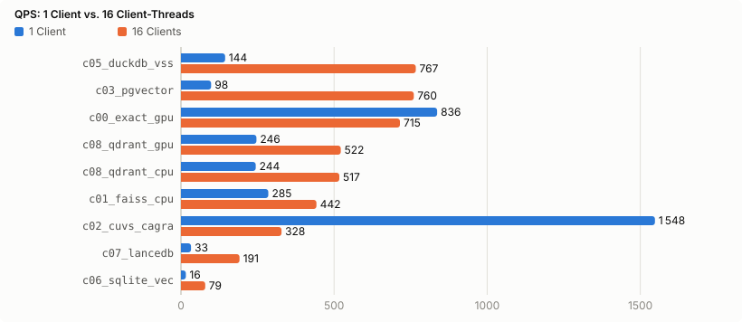

# ZeilenJoule

> *„Wie viele Joule kostet eine Zeile?"*

ZeilenJoule misst **zeilenweise RAG auf deutschen (NRW-)Industriedaten**: Störmeldungen, Q-Meldungen und Prüfprotokolle.
Jede Pipeline-Stufe (Einlesen, Normalisieren, Embedden, Indexieren, Suchen, LLM-Extraktion, Antworten) wird mit vielen Werkzeugen umgesetzt, von naivem pandas über Polars, GPU-Dataframes und reines Rust bis zu Datenbanken und lokalen LLMs.
Gemessen werden **Laufzeit und Energie (Joule)** auf einem Rechner mit NVIDIA RTX 5060 Ti 16 GB.
Der schnellste Stack, der alle Qualitätsprüfungen besteht, bekommt anschließend ein Go-basiertes Produktions-Setup.

## Status
**Phasen 0–9 abgeschlossen**: Track A–E sind gemessen (Dataframes, Embeddings, Speicherung/Suche, LLM-Extraktion, End-to-End-RAG); der Gewinner `e03_postgres_only` läuft als Go-Produktions-Stack und ist selbst als `e06_stack_go` gemessen. Lastkurve `e07_stack_load` gemessen: Ingest-SLO erfüllt, Such- und Erstes-Ereignis-SLO verfehlt (ADR 0026). Offen: Phase 10 (Portfolio).
Ergebnisse: [`reports/REPORT.de.md`](reports/REPORT.de.md) (English: [`reports/REPORT.md`](reports/REPORT.md)). Alle Zahlen dort stammen ausschließlich aus `results/` (Harness-Ausgabe) und werden von `task report` erzeugt. Ein Lauf zählt nur, wenn er die Prüfung gegen die Referenzimplementierung besteht.

| Phase | Inhalt | Status |
|---|---|---|
| 0 | Umgebungsprüfung, Kompatibilitätsmatrix | ✅ `docs/ENVIRONMENT.md`, `docs/COMPAT.md` |
| 1 | Gerüst: Taskfile, uv/cargo/Go-Projekte, Lint/Test | ✅ |
| 2 | Mess-Harness `zj` (Zeit + GPU/CPU-Energie), Kalibrierung | ✅ `docs/CALIBRATION.md`, `docs/METHODIK.md` |
| 3 | Synthetische NRW-Daten mit Gold-Labels, Fragen, reale Daten | ✅ `data/cards/` (Abruf realer Daten: `task data:fetch`) |
| 4 | Track A: Dataframe- und Zeilenverarbeitung (Python-Schleife, pandas, Polars inkl. GPU, cuDF, DuckDB, Rust) | ✅ gemessen |
| 5 | Track B: Embeddings (bge-m3: PyTorch, ONNX Runtime, TEI, vLLM, llama.cpp, Rust) | ✅ gemessen |
| 6 | Track C: Speicherung, Index, Suche (FAISS, cuVS, pgvector, DuckDB, SQLite, LanceDB, Qdrant, Tantivy; Konkurrenz 1/16, Hybrid-RRF) | ✅ gemessen |
| 7 | Track D: LLM-Extraktion (Ollama, llama.cpp, vLLM; Qwen 3.5, Gemma 4, Ministral, gpt-oss, EuroLLM, Teuken) | ✅ gemessen (inkl. GLiNER und Regeln+LLM-Kaskade) |
| 8 | Track E: End-to-End-RAG (4 Pipelines auf 1 Mio. Zeilen), Gewinneranalyse | ✅ gemessen · Gate 2: `reports/WINNER.md`, `docs/ARCHITEKTUR.md` |
| 9 | Produktion: Go-Gateway + Worker, Compose, k3s/Helm, Monitoring mit Energie, lokale CI/CD | ✅ `docs/RUNBOOK.md`, `docs/CI.md`, gemessen als `e06_stack_go` und `e07_stack_load` (2 von 3 SLOs verfehlt, ADR 0026) |
| 10 | Portfolio | offen |

<!-- zj:results:begin -->
## Ergebnisse (generiert)

Generiert von `task report` aus `results/` – Median der gemessenen Läufe der neuesten Session (3–5 je Wettbewerber), nur Läufe, die die Prüfung gegen die Referenz bestehen. Vollständige Tabellen mit Energie netto, Kosten, CO₂, Latenz und Qualität: [`reports/REPORT.de.md`](reports/REPORT.de.md).

### Track A: Dataframe- und Zeilenverarbeitung (`a.full`): Skala L (1 000 000 Zeilen)


| # | Wettbewerber | Wall s | × schnellster | Energie J (brutto) |
|---|---|---|---|---|
| 1 | `a17_rs_handrolled` | 0,91 | 1,00 | 56,0 |
| 2 | `a16_rs_arrow_rayon` | 2,69 | 2,94 | 96,9 |
| 3 | `a10_polars_lazy` | 3,62 | 3,96 | 252,1 |
| 4 | `a11_polars_streaming` | 3,63 | 3,97 | 254,3 |
| 5 | `a15_rs_polars` | 4,47 | 4,90 | 268,3 |
| 6 | `a13_duckdb_py` | 5,59 | 6,12 | 279,8 |
| 7 | `a23_polars_gpu_hybrid` | 5,89 | 6,44 | 335,9 |
| 8 | `a09_polars_eager` | 11,66 | 13 | 414,4 |
| 9 | `a07_cudf_pandas` | 28,35 | 31 | 1 125,1 |
| 10 | `a01_py_csv_loop` | 30,91 | 34 | 837,3 |
| 11 | `a06_pandas_arrow` | 34,25 | 37 | 865,6 |
| 12 | `a05_pandas_vectorized` | 35,52 | 39 | 910,7 |
| 13 | `a03_pandas_itertuples` | 35,87 | 39 | 984,2 |
| 14 | `a04_pandas_apply` | 82,51 | 90 | 2 307,2 |

### Track B: Embeddings (`b.embed`, bge-m3): Skala M (100 000 Dokumente)


| # | Wettbewerber | Wall s | × schnellster | Energie J (brutto) |
|---|---|---|---|---|
| 1 | `b06_tei` | 108,76 | 1,00 | 19 632,2 |
| 2 | `b10_rs_ort` | 110,06 | 1,01 | 21 451,0 |
| 3 | `b03_st_fp16_sorted` | 112,34 | 1,03 | 21 222,1 |
| 4 | `b04_ort_cuda` | 113,73 | 1,05 | 21 623,8 |
| 5 | `b02_st_fp16` | 146,47 | 1,35 | 23 943,7 |
| 6 | `b07_vllm_pooling` | 164,53 | 1,51 | 21 510,1 |
| 7 | `b08_llamacpp_embed` | 246,84 | 2,27 | 25 449,2 |
| 8 | `b01_st_fp32` | 458,78 | 4,22 | 87 935,6 |

### Track C: Speicherung, Index, Suche (`c.dense`): Skala M (100 000 Dokumente)


| # | Wettbewerber | Wall s | × schnellster | Energie J (brutto) |
|---|---|---|---|---|
| 1 | `c00_exact_gpu` | 4,48 | 1,00 | 228,4 |
| 2 | `c02_cuvs_cagra` | 6,24 | 1,39 | 263,9 |
| 3 | `c01_faiss_cpu` | 16,88 | 3,77 | 1 140,4 |
| 4 | `c05_duckdb_vss` | 26,81 | 5,99 | 1 388,1 |
| 5 | `c07_lancedb` | 46,37 | 10 | 1 080,9 |
| 6 | `c08_qdrant_cpu` | 46,43 | 10 | 885,6 |
| 7 | `c08_qdrant_gpu` | 50,74 | 11 | 712,1 |
| 8 | `c06_sqlite_vec` | 77,98 | 17 | 2 606,7 |
| 9 | `c03_pgvector` | 123,96 | 28 | 3 277,6 |



### Track C: Hybrid-Suche (`c.hybrid`, Dense + lexikalisch, RRF k = 60): Skala M (100 000 Dokumente)


| # | Wettbewerber | Wall s | × schnellster | Energie J (brutto) |
|---|---|---|---|---|
| 1 | `c08_qdrant_hybrid` | 66,62 | 1,00 | 1 071,9 |
| 2 | `c07_lancedb_hybrid` | 101,84 | 1,53 | 1 435,9 |
| 3 | `c03_pgvector_hybrid` | 125,14 | 1,88 | 4 187,8 |
| 4 | `c05_duckdb_hybrid` | 134,56 | 2,02 | 4 170,8 |
| 5 | `c06_sqlite_hybrid` | 184,24 | 2,77 | 4 699,6 |

### Track C: lexikalische Suche (`c.lexical`, BM25): Skala M (100 000 Dokumente)

| # | Wettbewerber | Wall s | × schnellster | Energie J (brutto) |
|---|---|---|---|---|
| 1 | `c11_tantivy` | 1,49 | 1,00 | 26,8 |

### Track D: LLM-Extraktion je Zeile (`d.extract`): Skala D2k (2 000 Zeilen)


| # | Wettbewerber | Wall s | × schnellster | Energie J (brutto) | macro-F1 | Gewinner-Gate |
|---|---|---|---|---|---|---|
| 1 | `d10_gliner` | 18,93 | 1,00 | 1 299,5 | 0,775 | ✗ |
| 2 | `d03_vllm_qwen35_9b_awq_3shot` | 376,10 | 20 | 49 290,2 | 0,964 | ✓ |
| 3 | `d11_cascade` | 388,93 | 21 | 34 925,0 | 0,966 | ✓ |
| 4 | `d03_vllm_qwen35_9b_fp8` | 440,62 | 23 | 58 722,0 | 0,946 | ✓ |
| 5 | `d03_vllm_qwen35_9b_awq` | 482,00 | 25 | 64 814,5 | 0,935 | ✓ |
| 6 | `d02_llamacpp_qwen35_4b_q4` | 506,14 | 27 | 51 199,0 | 0,936 | ✓ |
| 7 | `d02_llamacpp_gemma4_e4b_q4_3shot` | 522,12 | 28 | 46 512,6 | 0,962 | ✓ |
| 8 | `d02_llamacpp_gemma4_e4b_q4` | 532,84 | 28 | 46 580,0 | 0,961 | ✓ |
| 9 | `d02_llamacpp_qwen35_9b_q4_3shot` | 601,49 | 32 | 72 331,5 | 0,971 | ✓ |
| 10 | `d02_llamacpp_ministral3_14b_q4` | 641,46 | 34 | 94 288,4 | 0,938 | ✓ |
| 11 | `d02_llamacpp_qwen35_9b_q4` | 658,12 | 35 | 78 291,4 | 0,953 | ✓ |
| 12 | `d02_llamacpp_qwen35_9b_q8` | 747,96 | 40 | 89 770,5 | 0,949 | ✓ |
| 13 | `d01_ollama_qwen35_9b_q4` | 1 234,09 | 65 | 94 917,3 | 0,946 | ✓ |
| 14 | `d02_llamacpp_gemma4_12b_q4` | 1 604,34 | 85 | 154 713,6 | 0,919 | ✓ |

### Track E: End-to-End-RAG (`e.rag`): Skala L (1 000 000 Zeilen)


| # | Wettbewerber | Wall s | × schnellster | Energie J (brutto) | Qualität gesamt | Gewinner-Gate |
|---|---|---|---|---|---|---|
| 1 | `e06_stack_go` (Phase 9: Produktions-Stack, kein Kandidat) | 1 719,38 | 1,00 | 244 378,1 | 0,751 | ✓ |
| 2 | `e03_postgres_only` | 1 740,04 | 1,01 | 247 894,5 | 0,754 | ✓ |
| 3 | `e02_modern_embedded` | 1 864,44 | 1,08 | 288 648,8 | 0,745 | ✓ |
| 4 | `e05_best_of_tracks` | 1 953,58 | 1,14 | 261 518,7 | 0,757 | ✓ |
| 5 | `e01_classic_python` | 5 330,08 | 3,10 | 957 824,8 | 0,697 | ✓ |

<!-- zj:results:end -->

## Produktions-Stack (Phase 9)
Der Track-E-Gewinner als Dienst (ADR 0021–0025, Architektur: [`docs/ARCHITEKTUR.md`](docs/ARCHITEKTUR.md)):
- **Go-Gateway** (OpenAPI 3.1, API-Schlüssel, Ratenbegrenzung, SSE) und **Go-Worker** (River-Warteschlange in PostgreSQL) mit dem Rust-Parser aus Track A, TEI (bge-m3) und vLLM (Qwen3.5-9B AWQ) auf einer GPU.
- **Fragen beantworten:** Router (SQL ↔ Hybrid-Suche); jede LLM-SQL läuft durch eine AST-Prüfung (`pg_query`) und dann als Nur-Lese-Rolle mit Zeitlimit (ADR 0022).
- **Betrieb:** `task up` (Docker Compose) oder `task k3s:up` (Helm-Chart, PodSecurity „restricted“, NetworkPolicies, Backup-CronJob); Prometheus + Grafana mit GPU- und CPU-Energie (NVML/RAPL) – Joule pro Anfrage live. Handbuch: [`docs/RUNBOOK.md`](docs/RUNBOOK.md).
- **CI/CD lokal:** `task ci` (Lint, Tests inkl. Postgres-Integration, hadolint, helm lint + kubeconform, gitleaks, trivy) und `task ci:release` (Images, trivy image, SBOM); [`docs/CI.md`](docs/CI.md).
- **Gemessen wie jeder Wettbewerber:** `e06_stack_go` lädt dieselbe CSV über die HTTP-API und beantwortet dieselben 300 Fragen; Vergleich mit dem Skript in [`reports/WINNER.md`](reports/WINNER.md) (Abschnitt Phase 9). Lastkurve und SLOs: `e07_stack_load` (ADR 0026), Auswertung im Bericht.

## Schnellstart
```bash
task setup      # alle Abhängigkeiten aus den Lockfiles installieren, zj bauen
task doctor     # Umgebung prüfen (GPU, RAPL, Docker, Last, Werkzeuge)
task ci         # Lint + Tests für Python, Rust und Go
```
Voraussetzungen: Ubuntu 24.04, NVIDIA-Treiber ≥ 580, Docker (docker-ce) + NVIDIA Container Toolkit, uv, rustup, Go ≥ 1.27, go-task.

## Aufbau
`harness/` (Go: `zj`-CLI) · `libs/` (zjmark-Stufenmarker für Python/Rust/Go) · `contestants/` (Wettbewerber je Sprache/Umgebung) · `config/` · `spec/` · `docs/` (Plan, Methodik, ADRs).
Details: `docs/PLAN.md`, Entscheidungen: `docs/adr/`.

English version: [README.md](README.md)
