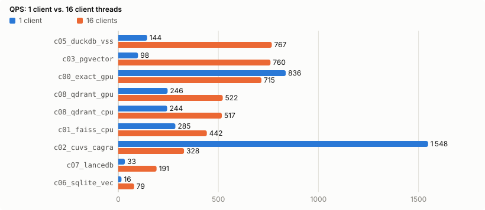

# ZeilenJoule

> *"How many joules does a row cost?"*

ZeilenJoule benchmarks **row-wise RAG on German (NRW) industrial data**: fault notifications, quality notifications and inspection logs.
Every pipeline stage (ingest, normalize, embed, index, retrieve, LLM extraction, answer) is implemented with many tools, from naive pandas to Polars, GPU dataframes, pure Rust, databases and local LLMs.
Each implementation is measured for **wall time and energy (joules)** on one machine with an NVIDIA RTX 5060 Ti 16 GB.
The fastest stack that passes every quality gate then gets a Go-based production setup.

## Status
**Phases 0–7 complete**: Tracks A (dataframes), B (embeddings), C (storage/index/search: dense, BM25, hybrid) and D (LLM extraction) are measured.
Results: [`reports/REPORT.md`](reports/REPORT.md) (German: [`reports/REPORT.de.md`](reports/REPORT.de.md)). Every number there comes only from `results/` (harness output) and is generated by `task report`. A run counts only if it passes verification against the reference implementation.

| Phase | Content | Status |
|---|---|---|
| 0 | Environment audit, compatibility matrix | ✅ `docs/ENVIRONMENT.md`, `docs/COMPAT.md` |
| 1 | Scaffold: Taskfile, uv/cargo/Go projects, lint/test | ✅ |
| 2 | Measurement harness `zj` (time + GPU/CPU energy), calibration | ✅ `docs/CALIBRATION.md`, `docs/METHODIK.md` |
| 3 | Synthetic NRW data with gold labels, questions, real data | ✅ `data/cards/` (real-data download: `task data:fetch`) |
| 4 | Track A: dataframe and row processing (Python loop, pandas, Polars incl. GPU, cuDF, DuckDB, Rust) | ✅ measured |
| 5 | Track B: embeddings (bge-m3: PyTorch, ONNX Runtime, TEI, vLLM, llama.cpp, Rust) | ✅ measured |
| 6 | Track C: storage, index, search (FAISS, cuVS, pgvector, DuckDB, SQLite, LanceDB, Qdrant, Tantivy; concurrency 1/16, hybrid RRF) | ✅ measured |
| 7 | Track D: LLM extraction (Ollama, llama.cpp, vLLM; Qwen 3.5, Gemma 4, Ministral, gpt-oss, EuroLLM, Teuken) | ✅ measured (incl. GLiNER and rules+LLM cascade) |
| 8 | Track E: end-to-end RAG, winner | next |
| 9–10 | Production (Go/DevOps), portfolio | open |

<!-- zj:results:begin -->
## Results (generated)

Generated by `task report` from `results/`: median of 5 measured runs of the latest session, only runs that pass verification against the reference. Full tables with net energy, cost, CO₂, latency and quality: [`reports/REPORT.md`](reports/REPORT.md).

### Track A: dataframe and row processing (`a.full`): scale L (1 000 000 rows)


| # | Contestant | wall s | × fastest | energy J (gross) |
|---|---|---|---|---|
| 1 | `a17_rs_handrolled` | 0.91 | 1.00 | 56.0 |
| 2 | `a16_rs_arrow_rayon` | 2.69 | 2.94 | 96.9 |
| 3 | `a10_polars_lazy` | 3.62 | 3.96 | 252.1 |
| 4 | `a11_polars_streaming` | 3.63 | 3.97 | 254.3 |
| 5 | `a15_rs_polars` | 4.47 | 4.90 | 268.3 |
| 6 | `a13_duckdb_py` | 5.59 | 6.12 | 279.8 |
| 7 | `a23_polars_gpu_hybrid` | 5.89 | 6.44 | 335.9 |
| 8 | `a09_polars_eager` | 11.66 | 13 | 414.4 |
| 9 | `a07_cudf_pandas` | 28.35 | 31 | 1 125.1 |
| 10 | `a01_py_csv_loop` | 30.91 | 34 | 837.3 |
| 11 | `a06_pandas_arrow` | 34.25 | 37 | 865.6 |
| 12 | `a05_pandas_vectorized` | 35.52 | 39 | 910.7 |
| 13 | `a03_pandas_itertuples` | 35.87 | 39 | 984.2 |
| 14 | `a04_pandas_apply` | 82.51 | 90 | 2 307.2 |

### Track B: embeddings (`b.embed`, bge-m3): scale M (100 000 docs)


| # | Contestant | wall s | × fastest | energy J (gross) |
|---|---|---|---|---|
| 1 | `b06_tei` | 108.76 | 1.00 | 19 632.2 |
| 2 | `b10_rs_ort` | 110.06 | 1.01 | 21 451.0 |
| 3 | `b03_st_fp16_sorted` | 112.34 | 1.03 | 21 222.1 |
| 4 | `b04_ort_cuda` | 113.73 | 1.05 | 21 623.8 |
| 5 | `b02_st_fp16` | 146.47 | 1.35 | 23 943.7 |
| 6 | `b07_vllm_pooling` | 164.53 | 1.51 | 21 510.1 |
| 7 | `b08_llamacpp_embed` | 246.84 | 2.27 | 25 449.2 |
| 8 | `b01_st_fp32` | 458.78 | 4.22 | 87 935.6 |

### Track C: storage, indexing, retrieval (`c.dense`): scale M (100 000 docs)


| # | Contestant | wall s | × fastest | energy J (gross) |
|---|---|---|---|---|
| 1 | `c00_exact_gpu` | 4.48 | 1.00 | 228.4 |
| 2 | `c02_cuvs_cagra` | 6.24 | 1.39 | 263.9 |
| 3 | `c01_faiss_cpu` | 16.88 | 3.77 | 1 140.4 |
| 4 | `c05_duckdb_vss` | 26.81 | 5.99 | 1 388.1 |
| 5 | `c07_lancedb` | 46.37 | 10 | 1 080.9 |
| 6 | `c08_qdrant_cpu` | 46.43 | 10 | 885.6 |
| 7 | `c08_qdrant_gpu` | 50.74 | 11 | 712.1 |
| 8 | `c06_sqlite_vec` | 77.98 | 17 | 2 606.7 |
| 9 | `c03_pgvector` | 123.96 | 28 | 3 277.6 |



### Track C: hybrid search (`c.hybrid`, dense + lexical, RRF k = 60): scale M (100 000 docs)


| # | Contestant | wall s | × fastest | energy J (gross) |
|---|---|---|---|---|
| 1 | `c08_qdrant_hybrid` | 66.62 | 1.00 | 1 071.9 |
| 2 | `c07_lancedb_hybrid` | 101.84 | 1.53 | 1 435.9 |
| 3 | `c03_pgvector_hybrid` | 125.14 | 1.88 | 4 187.8 |
| 4 | `c05_duckdb_hybrid` | 134.56 | 2.02 | 4 170.8 |
| 5 | `c06_sqlite_hybrid` | 184.24 | 2.77 | 4 699.6 |

### Track C: lexical search (`c.lexical`, BM25): scale M (100 000 docs)

| # | Contestant | wall s | × fastest | energy J (gross) |
|---|---|---|---|---|
| 1 | `c11_tantivy` | 1.49 | 1.00 | 26.8 |

### Track D: LLM row-wise extraction (`d.extract`): scale D2k (2 000 rows)


| # | Contestant | wall s | × fastest | energy J (gross) | macro-F1 | winner gate |
|---|---|---|---|---|---|---|
| 1 | `d10_gliner` | 18.93 | 1.00 | 1 299.5 | 0.775 | ✗ |
| 2 | `d03_vllm_qwen35_9b_awq_3shot` | 376.10 | 20 | 49 290.2 | 0.964 | ✓ |
| 3 | `d11_cascade` | 388.93 | 21 | 34 925.0 | 0.966 | ✓ |
| 4 | `d03_vllm_qwen35_9b_fp8` | 440.62 | 23 | 58 722.0 | 0.946 | ✓ |
| 5 | `d03_vllm_qwen35_9b_awq` | 482.00 | 25 | 64 814.5 | 0.935 | ✓ |
| 6 | `d02_llamacpp_qwen35_4b_q4` | 506.14 | 27 | 51 199.0 | 0.936 | ✓ |
| 7 | `d02_llamacpp_gemma4_e4b_q4_3shot` | 522.12 | 28 | 46 512.6 | 0.962 | ✓ |
| 8 | `d02_llamacpp_gemma4_e4b_q4` | 532.84 | 28 | 46 580.0 | 0.961 | ✓ |
| 9 | `d02_llamacpp_qwen35_9b_q4_3shot` | 601.49 | 32 | 72 331.5 | 0.971 | ✓ |
| 10 | `d02_llamacpp_ministral3_14b_q4` | 641.46 | 34 | 94 288.4 | 0.938 | ✓ |
| 11 | `d02_llamacpp_qwen35_9b_q4` | 658.12 | 35 | 78 291.4 | 0.953 | ✓ |
| 12 | `d02_llamacpp_qwen35_9b_q8` | 747.96 | 40 | 89 770.5 | 0.949 | ✓ |
| 13 | `d01_ollama_qwen35_9b_q4` | 1 234.09 | 65 | 94 917.3 | 0.946 | ✓ |
| 14 | `d02_llamacpp_gemma4_12b_q4` | 1 604.34 | 85 | 154 713.6 | 0.919 | ✓ |

<!-- zj:results:end -->

## Quick start
```bash
task setup      # install all locked dependencies, build zj
task doctor     # check the environment (GPU, RAPL, Docker, load, tools)
task ci         # lint + tests for Python, Rust and Go
```
Requirements: Ubuntu 24.04, NVIDIA driver ≥ 580, Docker (docker-ce) + NVIDIA Container Toolkit, uv, rustup, Go ≥ 1.27, go-task.

## Layout
`harness/` (Go: `zj` CLI) · `libs/` (zjmark stage markers for Python/Rust/Go) · `contestants/` (contestants per language/env) · `config/` · `spec/` · `docs/` (plan, methodology, ADRs).
Details: `docs/PLAN.md`. Decisions: `docs/adr/`.

Deutsche Version: [README.de.md](README.de.md)
